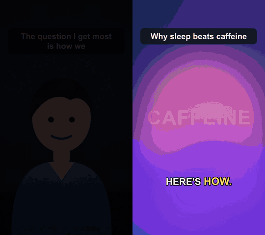
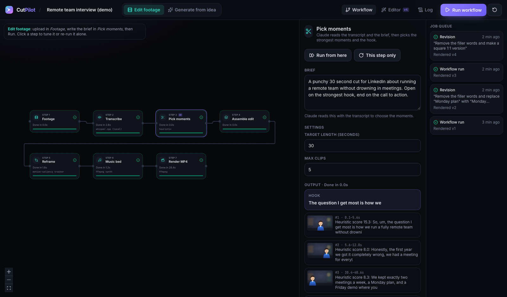
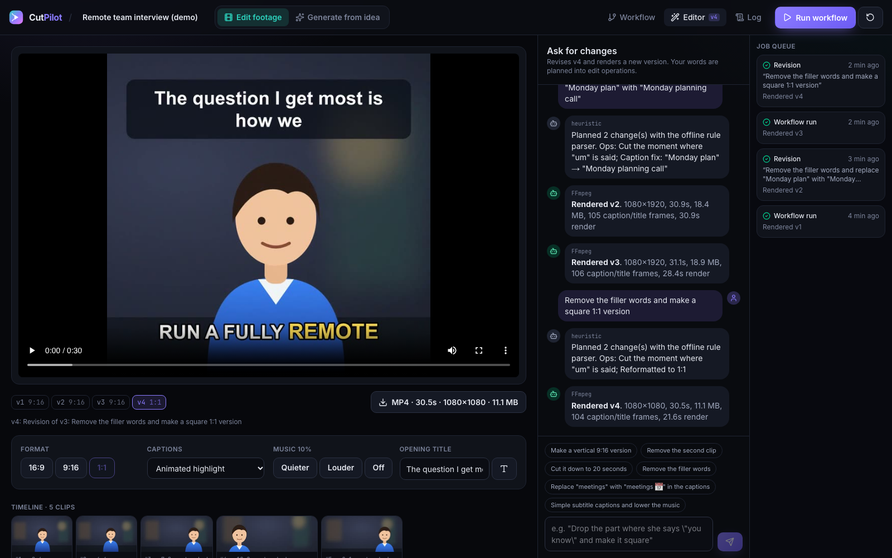
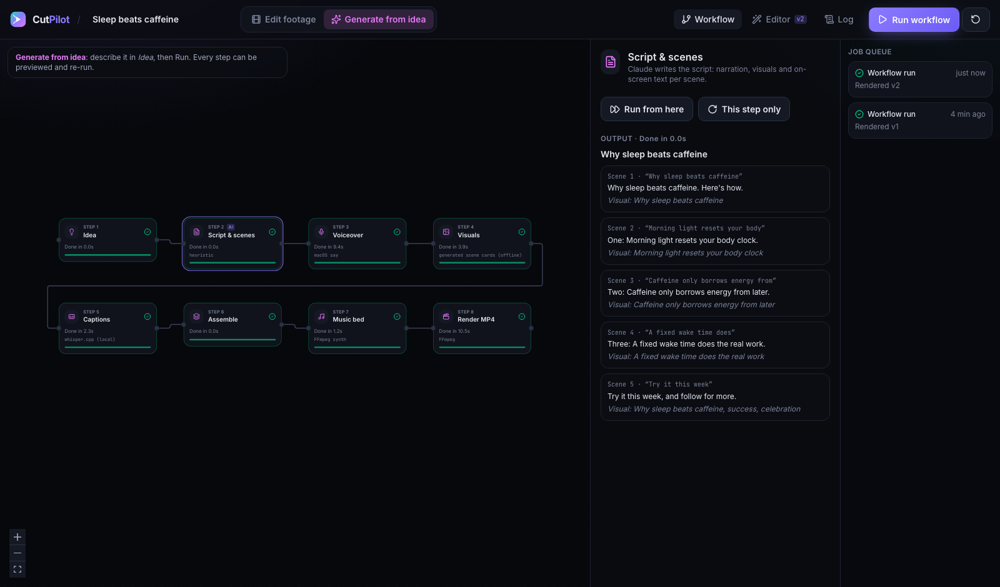
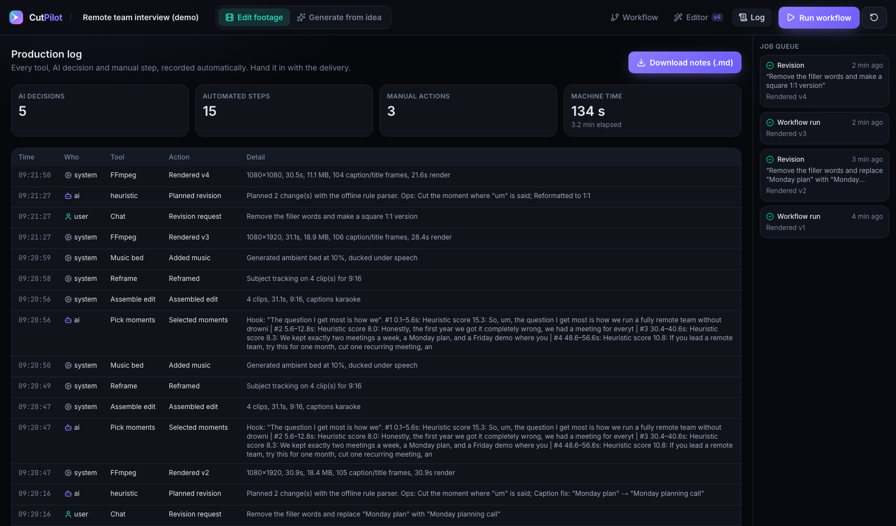
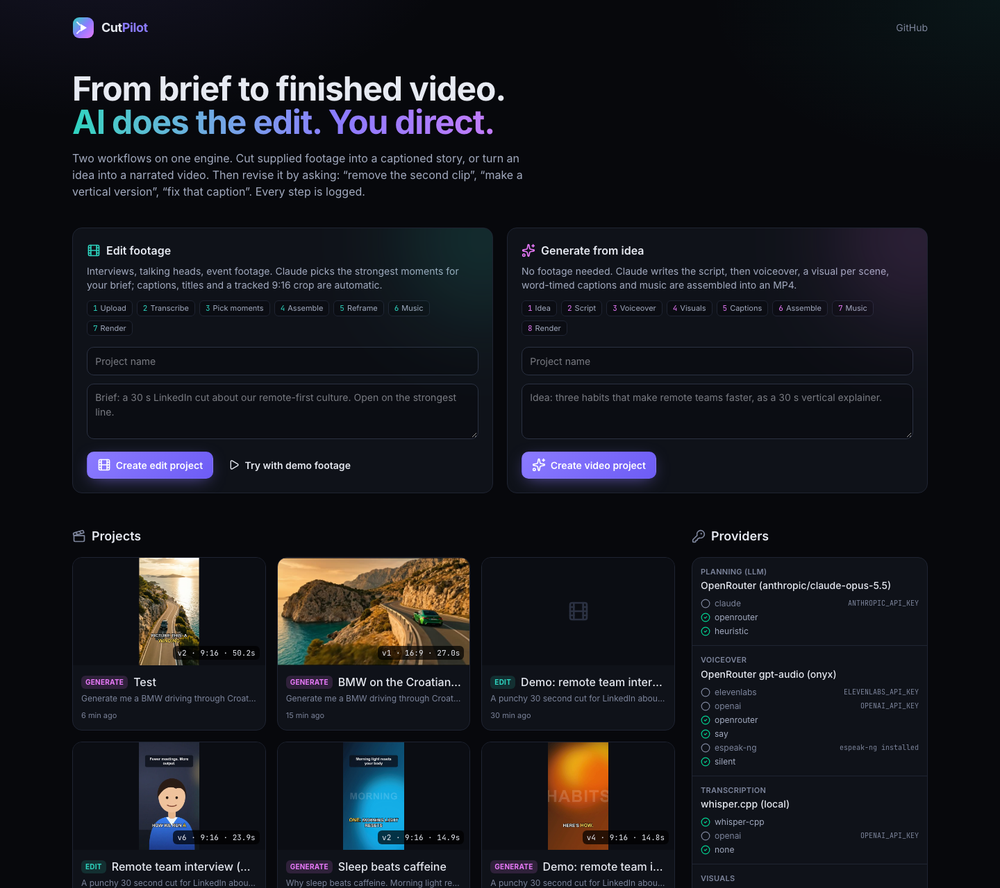
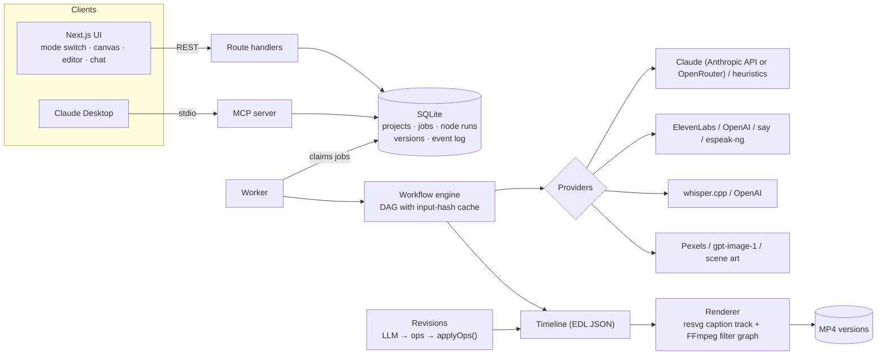

<div align="center">

# CutPilot

**An AI video workflow that produces real MP4s.** Cut supplied footage into a captioned story from a brief, or turn an idea into a narrated video. Then revise it by asking: *"remove the second clip"*, *"make a vertical version"*, *"fix that caption"*.

Claude plans the edit. FFmpeg renders it. Every step is logged.

[](https://github.com/sibrahimpa1/cutpilot/actions/workflows/ci.yml)




<sub>Both clips above were rendered by CutPilot with no API keys: local Whisper, macOS voice, generated art and music.</sub>

</div>

---

## What it does

Two workflows run on one engine. Switch between them at any time inside the same project; both produce the same kind of edit, so either one can be revised the same way.

| | **Edit footage** | **Generate from idea** |
| --- | --- | --- |
| Input | Interviews, talking heads, event footage, and a brief | One paragraph of idea, a length and a format |
| AI work | Transcribes, **picks the strongest moments for the brief**, writes the hook | **Writes the script**: narration, visuals and on-screen text per scene |
| Media | Subject-tracked reframing to 9:16 / 1:1, title card, animated captions, music bed | Voiceover, one visual per scene (stock, generated or offline art), word-timed captions, music |
| Output | H.264 MP4, any of 16:9, 9:16, 1:1 | H.264 MP4, any of 16:9, 9:16, 1:1 |

**Example (Generate, with an OpenRouter key):** *"Generate me a BMW driving through Croatia near the sea view, make it look cinematic and real, powerful and magical."* Claude decides it needs no narrator, writes a six-shot list with one precise subject (make, model, colour) and a shared look, a hero frame is generated, every shot's first frame is generated from it (same car every time), Veo animates each shot with its own engine and wave sound, Lyria scores it, and the shots are joined with crossfades.

Then, for either mode:

- **Revise by chat.** "Remove the part where he says 'you know' and make it square" becomes edit operations, then a new numbered version.
- **Revise by hand.** Reorder or delete clips, switch format, fix a caption word without touching the audio, change the title, turn the music down.
- **Re-run any step alone**, or from a step onwards. Unchanged steps are cached.
- **Production log.** Every tool, AI decision and manual action is recorded with timings, and exports as Markdown delivery notes.
- **MCP server.** Claude Desktop can run the whole workflow through conversation: import footage, run, revise, read the log.

## Screenshots

| Workflow canvas (Edit footage) | Editor with chat revisions |
| --- | --- |
|  |  |
| **Workflow canvas (Generate from idea)** | **Production log** |
|  |  |



## Quick start

Requirements: **Node 22.13+**, **pnpm**, **FFmpeg**. Optional: **whisper.cpp** for local transcription.

```bash
git clone https://github.com/sibrahimpa1/cutpilot.git
cd cutpilot
pnpm install
```

```bash
# macOS. On Linux: apt install ffmpeg espeak-ng, and build whisper.cpp (see Dockerfile)
brew install ffmpeg whisper-cpp
pnpm models:whisper        # ~148 MB local speech-to-text model
```

```bash
cp .env.example .env       # optional: add API keys (see below)
pnpm dev                   # web on http://localhost:3210 + background worker
```

Open the app and click **Try with demo footage**. It generates a short fictional interview (synthetic presenter, synthetic voice), creates an Edit project and you can press **Run workflow**.

### Docker

```bash
docker compose up --build  # http://localhost:3210
```

The image includes FFmpeg, espeak-ng, fonts and a compiled whisper.cpp; the worker downloads the Whisper model into the data volume on first start.

## API keys (all optional)

Without keys everything runs offline. Add any of these to `.env` and restart; the **Providers** panel on the home page shows what is active.

| Key | What it switches on | Offline fallback |
| --- | --- | --- |
| `ANTHROPIC_API_KEY` | Claude picks moments, writes scripts, plans free-form revisions (`claude-opus-5-5`, structured outputs) | Transparent heuristics: sentence scoring, a script template, a rule-based revision parser |
| `OPENROUTER_API_KEY` | **One key for the full AI production**: the Claude planner, **photoreal AI video per shot with native sound** (Veo 3.1 Fast by default), AI first frames that keep the same subject in every shot, a natural voice (gpt-audio) and composed music (Lyria). Every call's cost is written to the production log | as above, plus generated scene art and a synthesised music bed |
| `OPENAI_API_KEY` | gpt-4o-mini-tts voice, whisper-1 transcription, gpt-image-1 scene images | macOS `say` / espeak-ng, whisper.cpp, generated scene art |
| `ELEVENLABS_API_KEY` | ElevenLabs voice (preferred when set) | as above |
| `PEXELS_API_KEY` | Stock video or photo per scene (free key) | Generated scene art |

Providers are chosen in the order listed in `.env.example`, or forced with `LLM_PROVIDER`, `TTS_PROVIDER`, `STT_PROVIDER`, `VISUALS_PROVIDER`.

## Use it from Claude Desktop (MCP)

Add this to `claude_desktop_config.json` (use your own absolute path):

```json
{
  "mcpServers": {
    "cutpilot": {
      "command": "pnpm",
      "args": ["--silent", "-C", "/absolute/path/to/cutpilot", "mcp"]
    }
  }
}
```

Tools: `create_project`, `import_media`, `configure`, `run_workflow`, `get_project`, `get_edit`, `revise`, `apply_ops`, `production_log`, `list_projects`, `providers`. Jobs go through the same queue as the web app, so you can watch progress in the browser while Claude drives. If no worker is running, the MCP server runs the job itself.

> "Import ~/Movies/interview.mov into a new edit project, brief: 45 s for LinkedIn about our hiring process. Run it, then make a vertical version and remove the filler words."

## Architecture



**The timeline is the single source of truth.** Both workflows end in the same JSON edit decision list: clips with source in/out points, subject-tracking crop keyframes, the words spoken in each clip, titles, caption style and music. The AI never touches pixels; it produces data:

- **Moment selection** and **script writing** return JSON validated against a schema (Claude structured outputs, then Zod), and timestamps are snapped to real word boundaries before use.
- **Revisions** are planned into a small set of operations (`remove_clip`, `move_clip`, `trim_clip`, `remove_phrase`, `set_aspect`, `replace_caption_text`, `set_caption_style`, `set_title`, `set_music_volume`, `target_duration`, …). A pure function `applyOps(timeline, ops)` executes them. Every revision is reproducible, testable without an API key, and visible in the log.
- **Rendering** turns the timeline into one FFmpeg command: per-clip trim, crop/scale (or Ken Burns for stills), audio normalisation, concat, overlay, music with sidechain ducking, fades, H.264/AAC with `faststart`.

### Details worth knowing

- **Captions and titles** are drawn as SVG and rasterised with resvg into a transparent overlay track (an ffconcat list of PNG states), so they look the same on any FFmpeg build, with or without libass. Karaoke style highlights the word being spoken.
- **Caption fixes never touch audio**: replacements are stored on the timeline and applied when captions are drawn, so a misheard word can be corrected without re-cutting.
- **Generated captions use the script's spelling with timings from speech**: the voiceover is transcribed and aligned back to the script, so captions are exact even when the recogniser mishears a word.
- **Subject tracking** samples frames at 4 fps as 96×54 grayscale, scores columns by motion and contrast, takes the weighted centroid, then smooths it and limits pan speed so the virtual camera moves like an operator. The path becomes a piecewise-linear FFmpeg `crop` expression. No GPU and no model download.
- **Clean cuts**: clip padding never extends into a neighbouring word, so no stray syllables at edit points.
- **Caching**: each step is hashed from its params, upstream hashes, the brief, the assets and the active provider. "Run" redoes only what changed; "This step only" and "Run from here" force a step.
- **Jobs** live in SQLite and are claimed atomically, so you can run several workers; jobs interrupted by a crash are re-queued, and running jobs can be cancelled (FFmpeg is killed).

## Project structure

```
packages/core      engine: types, SQLite, providers, workflow nodes, renderer, revisions, report
  src/media        ffmpeg wrapper, render plan, caption overlays, tracking, music + scene art
  src/providers    Claude + heuristics, TTS, STT, visuals
  src/workflow     templates, node executors, cached DAG engine
  test/            unit tests + FFmpeg integration tests (real renders)
apps/web           Next.js 16 UI and API (React Flow canvas, editor, chat, log)
apps/worker        background job runner
apps/mcp           MCP server for Claude Desktop
scripts/           demo footage generator, Whisper model download, Docker entrypoint
```

## Development

```bash
pnpm test        # 51 tests: overlays, revisions, heuristics, tracking, speech, render + end-to-end workflow
pnpm typecheck
pnpm build
pnpm demo:footage
```

The end-to-end test runs the full Generate workflow with offline providers, renders an MP4, checks caching and single-step re-runs, applies a revision and reads the production log.

## Honest limitations

- The offline heuristics are deliberately simple; for real client work add `ANTHROPIC_API_KEY`. The rest of the pipeline is the same either way.
- Subject tracking follows motion and contrast, not faces specifically. It works well for one moving speaker; for multi-person shots you can switch the Reframe step to centre crop.
- Rendering is CPU H.264 (`veryfast`), roughly real time on a laptop.
- The demo interview is synthetic (generated presenter and voice) so the repo ships with no third-party footage.

## Author

**Senka Ibrahimpašić**, full-stack developer building AI products.
GitHub [@sibrahimpa1](https://github.com/sibrahimpa1)

## License

[MIT](LICENSE)
